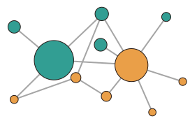
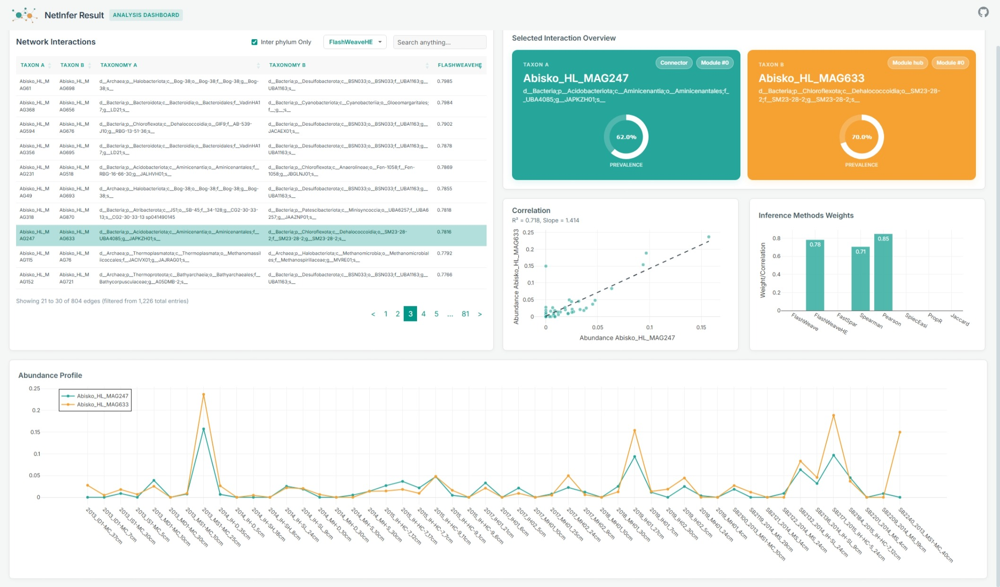

# NetInfer

[](https://opensource.org/licenses/MIT)
[](https://snakemake.github.io)
[](https://docs.conda.io/en/latest/)

A Snakemake-based pipeline for inferring microbiome co-abundance networks, integrating multiple inference tools in one workflow.

## Features

- Multiple network inference methods:
  - Direct Association Methods:
      - [FlashWeave (HE mode/normal mode)](https://github.com/meringlab/FlashWeave.jl)
      - [SPIEC-EASI](https://github.com/zdk123/SpiecEasi)
  - Correlation-based Methods:
      - [FastSpar](https://github.com/scwatts/fastspar)
      - [propR](https://www.nature.com/articles/s41598-017-16520-0)
      - [Spearman correlation with FDR correction](https://en.wikipedia.org/wiki/Spearman%27s_rank_correlation_coefficient)
      - [Pearson correlation with FDR correction](https://en.wikipedia.org/wiki/Pearson_correlation_coefficient)  
      - [Jaccard Index](https://en.wikipedia.org/wiki/Jaccard_index)

- Interactive HTML dashboard
- Flexible input formats (TSV, CSV, BIOM)
- Comprehensive output with consensus scores
- Parallel execution support
- Conda environment management

Output interactive html dashboard:



We provide an example in [example](example) directory, where you can learn the input file format and the expected output. Note that the example abundance table only illustrates the file format. For real analyses, use raw read counts (see [Abundance Tables](#abundance-tables)).

## Quick Start

### Prerequisites

- [Conda](https://docs.conda.io/en/latest/miniconda.html) (or [Mamba](https://github.com/mamba-org/mamba))

### Installation

```bash
# Clone the repository
git clone https://github.com/SilentGene/netinfer.git
cd netinfer

# Create and activate conda environment
conda env create -f environment.yaml  # creates 'netinfer' environment and installs dependencies
conda activate netinfer

# Install FlashWeave by running the provided Julia package
julia netinfer/workflow/scripts/install_flashweave.jl
```

### Basic Usage

1. Prepare your data:
   - Required: a read count table `count_table.tsv` (recommended) and/or a relative abundance table `relab_table.tsv`. If neither is available, use another abundance table such as coverage (see [Abundance Tables](#abundance-tables)).
   - (Optional) taxonomy table `taxonomy.tsv` for additional annotations
   - (Optional) sample metadata table `metadata.tsv` for `FlashWeave` and additional annotations

2. Run the pipeline:

```powershell
# Input files:
# 1. Read count table: for co-abundance analysis
# 2. Relative abundance table: for filtering and for the abundances shown in outputs
# 3. Taxonomy table: for additional annotations

netinfer \
    --input_count count_table.tsv \
    --input_relative_abundance relab_table.tsv \
    --taxonomy taxonomy.tsv \
    --output results_dir \
    --threads 6
```

### Other Usage Examples

```powershell
# Simple run with all methods enabled and using default settings
netinfer --input_count count_table.tsv --output results_dir --threads 6

# Only coverage is available (e.g. CoverM trimmed_mean): not optimal, but supported
netinfer --input_others trimmed_mean.tsv --output results_dir --threads 6

# Include taxonomy to allow more information in the output and produce a addictional file with associations between different phyla
netinfer --input_count count_table.tsv --output results_dir --threads 6 --taxonomy taxonomy.tsv

# I don't have a separate taxonomy file, but the taxonomy info is available from genome IDs
netinfer --input_count count_table.tsv --output results_dir --threads 6 --infer-taxonomy

# Only use my favorite methods, and use my own suffix for output files
netinfer --input_count count_table.tsv --output results_dir --threads 6 --methods flashweave,fastspar,spearman --suffix samples007

# Retain strong negative associations too (filter signed methods by absolute value)
netinfer --input_count count_table.tsv --output results_dir --threads 6 --include-negative

# Skip visualization
netinfer --input_count count_table.tsv --output results_dir --threads 6 --no-visual

# I'm an expert: specify every detail with my own config file
netinfer --input_count count_table.tsv --output results_dir --threads 6 --config my_config.yaml
```

### Output

The pipeline generates:
1. Filtered and processed input data (`results/preprocessed_data/`). `filtered_abundance.tsv` is used for network inference. `display_values.tsv` holds the values shown in the final tables and dashboard.
2. Individual network files for each method (`results/subtool_outputs/`)
3. Network statistics with modularity detection (`results/final_results/network_stats.txt`)
4. Merged network edges with consensus scores and community assignment (`results/final_results/merged_edges.tsv`)
5. Merged network nodes with Zi-Pi analysis (`results/final_results/merged_nodes.tsv`)
6. Interactive HTML dashboard (`results/final_results/netinfer_dashboard.html`)
7. Taxon–metadata associations found by FlashWeave (`results/final_results/metadata_associations.tsv`; only filled when `--metadata` is given)

## Input File Formats

### Abundance Tables
> No matter what column names are, the first column will always be treated as Feature IDs, and the rest columns as Sample IDs.
- Format: TSV/CSV/BIOM
- Rows: Features (OTUs/ASVs/genomes)
- Columns: Samples

Provide at least one of the following tables:

| Flag | Values | Used for |
| ---- | ------ | -------- |
| `--input_count` | **Raw read counts (strongly recommended)**, e.g. `coverm genome -m count` | Network inference |
| `--input_relative_abundance` | Relative abundance as a fraction (0–1) or a percentage (0–100), e.g. `coverm genome -m relative_abundance`. If every sample sums to ≤ 1, values are read as fractions; otherwise as percentages. | Abundance filtering and the abundances shown in the final tables and dashboard. Used for network inference only if no other table is given. |
| `--input_others` | Other non-negative abundance values, e.g. CoverM `trimmed_mean` or sandpiper `full_coverage`. **Not optimal**: use only if read counts are unavailable. Cannot be combined with `--input_count`. | Network inference |

- **Both tables (recommended)**: networks are inferred from counts. Abundances are reported as relative abundance (%). The two tables must share the same samples and features.
- **Counts only**: abundance-related columns are named after read counts (e.g. `Mean Read Count A`). The dashboard plots `log10(read count + 1)`. Relative abundance for filtering is computed from the counts.
- **Relative abundance only**: networks are inferred from relative abundance. FastSpar results are then unreliable and SPIEC-EASI results are biased, because both expect read counts.
- **Other values (± relative abundance)**: networks are inferred from the other values, with the same FastSpar and SPIEC-EASI caveats. Without a relative abundance table, abundance-related columns are named after input values (e.g. `Mean Input Value A`). The dashboard then plots `log10(value + c)`, where `c` is half the smallest non-zero value. Relative abundance for filtering is computed from the other values.

Example:
```
Feature        Sample1  Sample2  Sample3
OTU1           100      150      80
OTU2           50       60       40
...
```

### Taxonomy Table (Optional)
> No matter what column names are, the first column will always be treated as Feature IDs, and the second column as Taxonomy strings. Any additional columns are ignored.
- Format: TSV/CSV
- Required columns: 
  - Feature ID (matching abundance table)
  - Taxonomy string

Example:
```
Feature  Taxonomy
OTU1     d__Bacteria;p__Firmicutes;c__Clostridia
OTU2     d__Bacteria;p__Bacteroidetes;c__Bacteroidia
...
```

### Metadata Table (Optional)
> This table is only used by FlashWeave and for additional annotations in the final output.

FlashWeave models metadata variables together with the taxa. Categorical variables are split into one variable per category (e.g. `Group_g1`). FlashWeave's taxon–taxon edges are therefore conditioned on the metadata. Edges between a taxon and a metadata variable are written to `final_results/metadata_associations.tsv`, which also includes each taxon's FlashWeave weight and abundance statistics. These edges are excluded from the microbial network, so they do not affect communities, Zi-Pi roles or network statistics. Edges between two metadata variables are dropped.
- Format: TSV or CSV with a header
- First column: unique, nonempty sample names matching the abundance table columns exactly (no missing or extra samples). Samples removed during [preprocessing](#preprocessing-abundance-filtering) are dropped from the metadata automatically.
- Remaining columns: metadata variables.

Example:
```
Samples  Group  Location
Sample1  groupA  Site1
Sample2  groupB  Site2
Sample3  groupA  Site1
...
```

## Preprocessing (Abundance Filtering)

Before network inference, NetInfer filters the abundance table once, and every method uses the result. By default:

1. Rows named `unmapped` or `undefined` are removed.
2. **Samples** with fewer than **1000 reads** are removed. This step only runs when a count table is given.
3. **Features** are kept only if they are present (> 0) in **≥ 10% of samples** and reach a **peak relative abundance ≥ 0.1%** in at least one sample. Relative abundance comes from `--input_relative_abundance` if given. Otherwise it is computed per sample from the counts (or from the `--input_others` values). It is used only for this check: the filtered table keeps your original values.
4. Features with the same value in every sample are removed.

You can change any threshold with a CLI flag or in a config file:

| CLI flag                   | Config key               | Default | Meaning |
| -------------------------- | ------------------------ | ------- | ------- |
| `--min-sample-depth`       | `min_sample_depth`       | `1000`  | Minimum total reads per sample (count table only; `0` disables) |
| `--min-prevalence`         | `min_prevalence`         | `0.1`   | Minimum fraction of samples in which a feature is present |
| `--min-prevalent-samples`  | `min_prevalent_samples`  | `0`     | Minimum number of samples in which a feature is present (`0` disables). This is useful for small datasets: 10% of 20 samples is only 2. |
| `--min-peak-rel-abundance` | `min_peak_rel_abundance` | `0.001` | Minimum peak relative abundance (`0.001` = 0.1%) |

```bash
netinfer --input_count count_table.tsv --output results_dir --min-prevalence 0.2 --min-prevalent-samples 10
```

The results are written to `<output>/preprocessed_data/`. `filtered_abundance.tsv` is the filtered table used for inference. `display_values.tsv` holds the same samples and features as relative abundance (%). Without a relative abundance table, it holds the read counts or the `--input_others` values instead. `abundance_stats.tsv` lists the samples and features before and after filtering, the removed samples, and the thresholds used. NetInfer also warns in `<output>/logs/preprocess_abundance.log` if inference uses non-count data, if the counts are not integers, or if more features than samples remain.

## Configuration

See `netinfer/config/config.yaml` for all available and default parameters and their descriptions.

## Method Configurations

Default:

**Trusted methods**

> Associations must be present in at least one method from these trusted methods to be retained in the final aggregated table.

| Method                   | Default Parameters                             |
| ------------------------ | -----------------------------------------------|
| FlashWeave (HE / normal) | P-value ≤ 0.001<br>Weight ≥ 0.4                |
| SPIEC-EASI               | Weight ≥ 0.3<br>Method: MB (default) or GLasso |


**Other methods**:

| Method             | Default Parameters                                                                    |
| ------------------ | ------------------------------------------------------------------------------------- |
| FastSpar           | P-value ≤ 0.05<br>Iterations: 50<br>Bootstraps: 1000<br>Correlation ≥ 0.2<br>Final correlation ≥ 0.3 |
| propR              | Rho ≥ 0.7                                                                             |
| Spearman           | FDR ≤ 0.05<br>Correlation ≥ 0.7                                                       |
| Pearson            | FDR ≤ 0.05<br>Correlation ≥ 0.7<br>CLR transformation implemented                     |
| Jaccard            | Similarity ≥ 0.7                                                                      |

By default, signed methods retain only positive associations that meet their
configured thresholds. Add `--include-negative` to apply each threshold to
the absolute value instead. For example, with a threshold of `0.7`, both
correlations `≥ 0.7` and `≤ -0.7` are retained. This applies to FlashWeave,
FastSpar, propR, Spearman, Pearson, and SPIEC-EASI. Jaccard is unchanged because
its similarity values are non-negative.

The same behavior can be enabled in a YAML configuration file:

```yaml
include_negative: true
```

## Troubleshooting

If you see an error like:

```
LockException:
Error: Directory cannot be locked. Please make sure that no other Snakemake process is trying to create the same files...
```

it usually means a previous Snakemake run was interrupted and left a lock behind. You can safely unlock and continue.

```bash
netinfer <original_args> --snake_args="--unlock"
```

## FAQ

> [!NOTE]
> **Q: Larger genomes get more reads. Doesn't using raw read counts bias the network?**
>
> **A: Not the network.** A genome twice as large gets about twice as many reads in *every* sample. This is a fixed multiplier for that genome. Network methods only look at how each genome's abundance rises and falls *across samples*, so the multiplier has no effect. In the log-ratio methods (e.g. CLR) it becomes a constant that cancels out.
>
> Genome size does matter when you compare different genomes with each other (e.g. "Is genome A more abundant than genome B?"), and for the abundance filter. To handle this, also provide a length-corrected table with `--input_relative_abundance`, such as the output of `coverm genome -m relative_abundance`. NetInfer then uses it for filtering and for the abundances shown in outputs, while the network is still inferred from read counts.

> [!NOTE]
> **Q: I only have a relative abundance table. Can I still trust the results?**
>
> **A: Mostly, but not for every method.** Most methods only need the *proportions* of each feature, which relative abundance keeps. Two methods are built for read counts:
>
> | Method | With relative abundance only |
> | ------ | ---------------------------- |
> | FlashWeave (normal / HE), propR, Pearson, Spearman, Jaccard | ✅ Reliable |
> | SPIEC-EASI | ⚠️ Biased: it adds a fixed pseudocount of 1 before CLR. On fractions (0–1) this 1 outweighs the real values; on percentages it still distorts low-abundance features. |
> | FastSpar | ❌ Unreliable: it samples compositions from the values as if they were read counts. |
>
> Our advice:
> 1. **If you have the read alignments (e.g. BAM files), generate a count table** with `coverm genome -m count` and provide it with `--input_count`. This is usually quick and gives the most reliable results.
> 2. **Otherwise, leave out the two count-based methods:**
>    ```bash
>    netinfer --input_relative_abundance relab_table.tsv --output results_dir \
>        --methods flashweave,flashweaveHE,propr,pearson,spearman,jaccard
>    ```
>    FlashWeave and FlashWeave HE remain as trusted methods.
>
> Without read counts, NetInfer also cannot remove shallowly sequenced samples (`--min-sample-depth`), so check your sequencing depths yourself.

> [!NOTE]
> **Q: Do I need to transform my compositional data (e.g. CLR, log, rarefaction) before running NetInfer?**
>
> **A: No. Provide the untransformed raw read counts.** Each method already handles compositionality, either internally or through NetInfer:
>
> - **FlashWeave**: CLR transformation with an adaptive pseudocount in normal mode, and CLR on non-zero values only in HE mode.
> - **SPIEC-EASI**: CLR transformation after adding a pseudocount of 1.
> - **FastSpar**: SparCC log-ratio variances computed on compositions sampled from the counts.
> - **propR**: proportionality (rho) on CLR-transformed data.
> - **Pearson**: Pearson correlation is not compositionally aware, so NetInfer applies a CLR transformation before computing it.
> - **Spearman**: NetInfer converts each sample to relative abundance first, so differences in sequencing depth do not create spurious rank correlations. Spearman does not correct for compositional effects, so interpret its edges with more caution.
> - **Jaccard**: uses presence/absence only, so no transformation is needed.
>
> For propR and Pearson, NetInfer handles zeros according to the data scale. For integer counts it adds a pseudocount of 1. For non-integer data it replaces each zero with half of that sample's smallest non-zero value.
>
> Pre-transformed input can break the pipeline. CLR or log values can be negative, which breaks prevalence filtering and count-based methods. A transformation applied twice also distorts the results.

## ALL flags
```powershell
$ netinfer --help
usage: netinfer [-h] [--input_count INPUT_COUNT] [--input_relative_abundance INPUT_RELATIVE_ABUNDANCE]
                [--input_others INPUT_OTHERS]
                [--output OUTPUT] [--taxonomy TAXONOMY]
                [--infer-taxonomy] [--metadata METADATA] [--methods METHODS] 
                [--config CONFIG] [--threads THREADS] [--no-visual]
                [--include-negative] [--min-sample-depth MIN_SAMPLE_DEPTH]
                [--min-prevalence MIN_PREVALENCE] [--min-prevalent-samples MIN_PREVALENT_SAMPLES]
                [--min-peak-rel-abundance MIN_PEAK_REL_ABUNDANCE] [--snake-args SNAKE_ARGS] [--suffix SUFFIX]

NetInfer: Microbiome Network Inference Pipeline

options:
  -h, --help            show this help message and exit
  --input_count, --input-count INPUT_COUNT
                        Read count table (TSV/CSV/BIOM; features x samples), e.g. from `coverm genome -m count`.
                        Recommended; used for network inference. Overrides config file if specified.
  --input_relative_abundance, --input-relative-abundance INPUT_RELATIVE_ABUNDANCE
                        Relative abundance table (TSV/CSV/BIOM; features x samples; fraction or percentage), e.g.
                        from `coverm genome -m relative_abundance`. Used for abundance filtering and display; used
                        for network inference only if --input_count is not given. Overrides config file if specified.
  --input_others, --input-others INPUT_OTHERS
                        Other abundance table (TSV/CSV/BIOM; features x samples) with non-negative values that are
                        neither read counts nor relative abundance, e.g. CoverM `trimmed_mean` or sandpiper
                        `full_coverage`. Not optimal: use only if read counts are unavailable. Used for network
                        inference; cannot be combined with --input_count.
  --output OUTPUT       Output directory for results. Overrides config file if specified.
  --taxonomy TAXONOMY   Taxonomy mapping file (optional)
  --infer-taxonomy      Infer taxonomy from feature IDs in the abundance table (looks for 'd__' or 'p__')
  --metadata METADATA   Sample metadata file used by FlashWeave and for additional annotations in the final output (optional)
  --methods METHODS     Comma-separated list of methods to use (default: all). Available methods: flashweave, flashweaveHE, fastspar,
                        pearson, spearman, spieceasi, propr, jaccard
  --config CONFIG       Path to a base config YAML file. CLI arguments will override settings in this file. The final merged config will be
                        saved to the output directory.
  --threads THREADS     Number of threads to use (default: 1)
  --no-visual           Skip visualization generation
  --include-negative    Apply signed association thresholds to absolute values, retaining strong negative as well as positive associations
  --snake-args, --snake_args SNAKE_ARGS
                        Additional Snakemake command-line arguments as a single string, e.g. 
                        --snake-args "--unlock --rerun-incomplete --dry-run"
  --suffix SUFFIX       Optional suffix to append to final aggregated outputs (inserted before file extension). Invalid filename characters
                        will be replaced with '_'

abundance filtering (overrides config; see README 'Preprocessing'):
  --min-sample-depth MIN_SAMPLE_DEPTH
                        Drop samples with fewer total reads (integer counts only; 0 disables). Default: 1000
  --min-prevalence MIN_PREVALENCE
                        Minimum fraction of samples in which a feature is present (> 0). Default: 0.1
  --min-prevalent-samples MIN_PREVALENT_SAMPLES
                        Minimum number of samples in which a feature is present (0 disables). Default: 0
  --min-peak-rel-abundance MIN_PEAK_REL_ABUNDANCE
                        Minimum peak (max per-sample) relative abundance of a feature, e.g. 0.001 = 0.1%. Default: 0.001
```

### Continue from interrupted runs
As Snakemake supports resuming from interrupted runs, you can simply re-run the same command to continue from where it left off.

## Contributing

Contributions are welcome! Please feel free to submit a Pull Request.

## Citation

NetInfer has not been published in a peer-reviewed journal yet. If you use NetInfer in your research, please cite:

```bibtex
@software{netinfer,
  author = {Heyu Lin},
  title = {NetInfer: A Snakemake Pipeline for Microbiome Network Inference},
  year = {2025},
  url = {https://github.com/SilentGene/NetInfer}
}
```

# Future plans
- Radar plot for abundance profiles.
- PCA plot for samples according to taxon abundance.

## Contact

Heyu Lin - heyu.lin🌀qut.edu.au

...🧙‍♂️🧬
